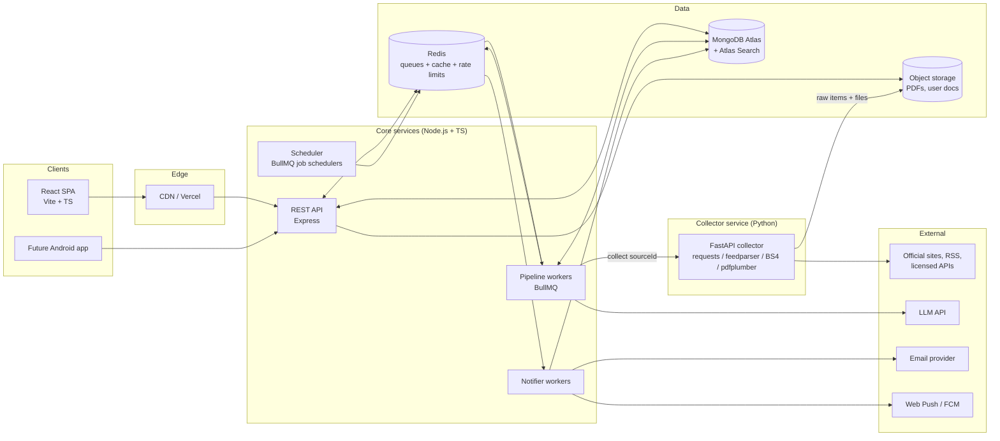
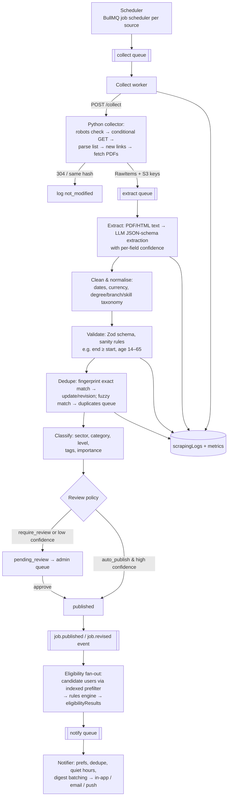

# CareerRadar — Architecture & Technical Plan (v1.0)

> Scope of this document: the "First Task" from the master prompt — requirements analysis, architecture, modules, stack, MongoDB schema, REST API, folder structure, data sources, collection architecture and timeline. No application code yet.

---

## 0. Executive summary

- **What we're building:** a multi-tenant career-intelligence platform with four content pipelines (Jobs, Tech Radar, Industry/Market News, Learning) feeding a personalised dashboard, an eligibility engine, an application tracker and a notification system, plus an admin console for source and data-quality control.
- **Hardest problems (in order):**
  1. **Extracting structured, trustworthy job data from official sources** — most Indian government notifications are PDFs (often bilingual, sometimes scanned) posted on HTML pages with no API or RSS.
  2. **Eligibility correctness** — rules depend on "age as on" cut-off dates, category relaxations, "appearing" candidates, branch equivalences, and are frequently revised by corrigenda.
  3. **Legal/ToS-compliant collection** — many aggregators (Naukri, LinkedIn, Indeed) prohibit scraping; we must rely on official pages, RSS, and licensed APIs.
- **Key design decisions:**
  - **Deterministic rules engine decides eligibility; the LLM only extracts and explains.** An LLM never marks anyone GREEN.
  - **Field-level provenance:** every critical job field is stored with `status: confirmed | estimated | not_specified` and the source it came from.
  - **Human-in-the-loop for government jobs at launch:** LLM-extracted records go to an admin review queue before being shown as "Verified".
  - **Adaptive polling with conditional HTTP requests** instead of blanket 1–5 minute scraping (see §8.4 — this is a deliberate adjustment to the brief).
  - **Monorepo, TypeScript end-to-end, shared Zod schemas**, Python only where it is genuinely stronger (PDF/HTML extraction).

---

## 1. Requirements analysis

### 1.1 Actors
| Actor | Description |
|---|---|
| Guest | Browses public jobs, news, tech radar, learning resources. No personalisation. |
| User | Registered. Profile, eligibility, recommendations, tracker, notifications. |
| Moderator | Reviews collected jobs, resolves reports and duplicates. |
| Admin | Everything a moderator can do + manage users, sources, categories, broadcasts, system config. |
| System workers | Collectors, pipeline processors, notifier, schedulers. |

### 1.2 Functional requirements → modules
| # | Requirement area | Module | Phase |
|---|---|---|---|
| 1 | Auth, profile, RBAC | Identity | 1 |
| 2 | Job listings, detail, search/filter | Jobs | 2 |
| 3 | Source registry & automated collection | Ingestion | 3 |
| 4 | Eligibility & match score | Eligibility | 4 |
| 5 | Tech Radar, Industry & Market News | Content | 5 |
| 6 | Application tracker & reminders | Tracker | 6 |
| 7 | Notifications (in-app, email, web push) | Notifications | 6 |
| 8 | AI summaries, skill-gap, roadmaps | AI | 7 |
| 9 | Learning centre | Learning | 5–7 |
| 10 | Admin console, analytics, review queue | Admin | 2–8 (incremental) |

### 1.3 Non-functional requirements
| Concern | Target |
|---|---|
| Availability | 99.5% for API/web at launch |
| Latency | p95 < 300 ms for list/search APIs (cached), < 800 ms for eligibility-on-demand |
| Freshness | New items on monitored official sources visible within the source's configured interval + ≤ 5 min pipeline time |
| Scale (year 1 design point) | 100k users, 50k active jobs, 1M news/tech items, 500 sources |
| Security | OWASP ASVS L1, bcrypt/argon2, JWT rotation, RBAC, rate limits |
| Privacy | India **DPDP Act 2023** alignment: consent, purpose limitation, data export/delete, sensitive fields optional |
| Portability | API-first so a future Android app reuses everything |

### 1.4 Gaps / additions to the brief (recommended)
These are needed for correct eligibility or compliance and are not in the original field list:

1. **Profile additions:** `category` (GEN/EWS/OBC-NCL/SC/ST), `pwbd`, `exServiceman`, `nationality`, `domicileState`, `gender` (some posts have gender-specific relaxations), `isFinalYear/appearing`, `languagesKnown` (state PSC local-language requirement). All optional, consented, encrypted at rest — they're sensitive.
2. **Job additions:** `ageCutoffDate` ("age as on"), `categoryRelaxations[]`, `appearingCandidatesAllowed`, `nationalityRule`, `domicileRule`, `corrigenda[]`.
3. **Extra collections:** `JobRevisions` (history of changes), `RawDocuments` (fetched snapshots for audit/re-processing), `Reports` (user-reported errors), `PushSubscriptions`, `RefreshTokens`.

---

## 2. System architecture

### 2.1 High-level view



### 2.2 Architectural style
- **Modular monolith API** (one Express app, strict module boundaries: `modules/jobs`, `modules/auth`, …). Microservices are premature at this scale; boundaries let us split later.
- **Separate worker process** (same codebase, different entrypoint) for queues — keeps API latency independent of ingestion load.
- **Python collector as an internal stateless HTTP service.** Node workers own scheduling, retries and state; Python only does "fetch + extract → normalised JSON". This avoids running BullMQ in two languages.
- **Event-driven pipeline** over Redis/BullMQ queues; each stage is idempotent and retryable.

### 2.3 Request flow examples
- **User opens a job:** SPA → `GET /api/v1/jobs/:slug` → API reads Mongo (Redis-cached 60 s) → if authenticated, attaches cached `EligibilityResult` or computes it synchronously (rules engine is pure TS, < 5 ms).
- **New SBI notification appears:** Scheduler enqueues `collect:sbi-careers` → worker calls collector → collector does conditional GET, detects new PDF link, downloads to S3, extracts text → worker runs clean → LLM structured extraction → validate → dedupe → classify → store as `pending_review` → moderator approves → `job.published` event → eligibility fan-out for matching users → notifications.

---

## 3. Module design

| Module | Responsibilities | Key components |
|---|---|---|
| **Identity** | Register, login, email verify, password reset, JWT access/refresh, RBAC, sessions | `auth.service`, `rbac.middleware`, `RefreshTokens` |
| **Profile** | Profile CRUD, education/skills normalisation, consent records, data export/delete | `profile.service`, skill taxonomy |
| **Jobs** | Listings, detail, filters, sorting, history, reports, expiry | `jobs.service`, `search.service` (Atlas Search) |
| **Organizations** | Org master data, logos, official domains (used to verify "official" links) | `orgs.service` |
| **Ingestion** | Source registry, scheduling, collection, pipeline stages, scrape logs, link checker | scheduler, pipeline workers, Python collector |
| **Eligibility** | Rule evaluation, match score, explanations, fan-out on new job/profile change | `@careerradar/eligibility` package (pure functions) |
| **Content** | Tech updates & news ingestion, categorisation, summaries, importance scoring | content pipeline, `news.service`, `tech.service` |
| **Tracker** | Applications CRUD, status timeline, documents, reminders | `applications.service`, S3 presigned URLs |
| **Notifications** | Rules → in-app/email/push, preferences, digests, dedupe, quiet hours | notifier worker, templates |
| **Learning** | Resources, roadmaps, syllabus, links to jobs/exams | `learning.service` |
| **AI** | Provider-agnostic LLM client, prompt registry, JSON-schema outputs, caching, cost tracking | `ai/` module |
| **Admin** | Users, sources, review queue, duplicates, reports, analytics, API usage, broadcasts | `/admin` routes + admin UI section |

### 3.1 Eligibility engine (core logic)

Each criterion returns a **tri-state**: `PASS | FAIL | UNKNOWN`, plus a human-readable reason.

| Criterion | Mandatory? | Logic notes |
|---|---|---|
| Qualification level | Yes | Ordinal: 10th < 12th < Diploma < UG < PG < PhD; "appearing" allowed only if job says so |
| Degree | Yes | Normalised degree codes (B.E./B.Tech treated as equivalent; mapping table) |
| Branch | Yes (if specified) | Branch taxonomy with equivalence groups (e.g., CSE ≈ IT ≈ "Computer Science & Engg") — admin-editable |
| Age | Yes | Computed **on `ageCutoffDate`**, not today; apply category/PwBD/ex-serviceman relaxation |
| Percentage/CGPA | Yes (if specified) | CGPA→% only with the university's official formula; else `UNKNOWN` |
| Experience | Yes (if specified) | Months of relevant experience |
| Nationality/domicile | Yes (if specified) | |
| Skills | No (soft) | Overlap ratio with required skills |
| Location / salary / sector preference | No (soft) | Preference fit |

**Status:**
- any mandatory `FAIL` → **RED**
- else any mandatory `UNKNOWN` (job side *or* profile side) → **YELLOW**
- else → **GREEN**

**Match score (0–100, compatibility not selection probability):**
```
mandatoryScore = Σ w_i · s_i / Σ w_i   over mandatory criteria, s = 1 PASS, 0.5 UNKNOWN, 0 FAIL
softScore      = Σ v_j · s_j / Σ v_j   over soft criteria (skills, location, salary, preference)
score          = round(100 · (0.7 · mandatoryScore + 0.3 · softScore))
RED  → capped at 40;  YELLOW → capped at 85
```
Weights live in config, versioned (`engineVersion` stored with each result) so scores are reproducible.

The LLM's role: (a) extract the job's criteria into the structured schema, (b) write the friendly "why it matches" paragraph *from the engine's criterion results*. It never changes the status.

---

## 4. Final technology stack

The brief's stack is sound. Recommendations and small additions:

| Layer | Choice | Why / notes |
|---|---|---|
| Monorepo | **pnpm workspaces + Turborepo** | Shared types/schemas between web, API, workers |
| Frontend | React 18, Vite, TypeScript, Tailwind CSS, React Router, TanStack Query, Recharts, Lucide | As specified. Add **shadcn/ui** (Radix-based, accessible components) and **react-hook-form + Zod** |
| Backend | Node.js 20 LTS, Express, TypeScript | As specified. Add **Zod** (validation), **pino** (logging), **helmet**, **express-rate-limit** (Redis store) |
| Auth | JWT access (15 min) + rotating refresh token (httpOnly cookie, 30 d), **argon2id** hashing | Refresh tokens stored hashed for revocation |
| DB | MongoDB Atlas + Mongoose | Use **Atlas Search** for full-text, fuzzy and faceted search (far better than `$text` for "smart search") |
| Queue/cache | Redis + **BullMQ** (job schedulers for repeatable collection) | Also used for rate-limit counters, per-domain politeness locks, API cache |
| Collector | Python 3.12, FastAPI, httpx/requests, feedparser, BeautifulSoup4, **pdfplumber/PyMuPDF**, **Tesseract OCR** (fallback for scanned PDFs) | Python's PDF/HTML tooling is the reason for this service |
| AI | Provider-agnostic client (OpenAI / Anthropic / Gemini) using **JSON-schema structured outputs** | Cache by content hash; per-feature token budgets |
| Email | Amazon SES or Resend | Cheap, reliable |
| Push | Web Push (VAPID) now; FCM later for Android | |
| Storage | AWS S3 (or Cloudflare R2 — no egress fees) | PDFs, snapshots, user documents (private, presigned URLs) |
| Observability | pino → log sink, **Sentry** (errors), **OpenTelemetry** + Grafana Cloud free tier (metrics), Bull Board (queues) | |
| Testing | Vitest, Supertest, Playwright, pytest, mongodb-memory-server | |
| CI/CD | GitHub Actions; Docker images for API/worker/collector | |
| Hosting (cost-effective start) | Web: **Vercel**. API + worker + collector: **Render** (or AWS ECS Fargate when scaling). DB: **Atlas** (M0 for dev, M10+ for prod). Redis: **Upstash** or Render Key Value | Move to AWS when traffic justifies it |

---

## 5. MongoDB schema

Conventions: all collections have `createdAt`, `updatedAt` (Mongoose `timestamps`). IDs are ObjectIds. Enums are validated with Zod at the API and Mongoose at the DB layer. Pagination is **cursor-based** (`_id`/sort-key cursors) for feeds and offset-based only for admin tables.

### 5.0 Shared sub-document: `Fact<T>` (field-level provenance)
```ts
Fact<T> = {
  value: T | null,
  status: 'confirmed' | 'estimated' | 'not_specified',
  source?: 'official_notification' | 'official_page' | 'api' | 'llm_extracted' | 'admin',
  verifiedAt?: Date
}
```
UI rule: `not_specified` → "Not specified"; `estimated` → shown with an "Estimated" badge; only `confirmed` from an official source counts as verified.

### 5.1 `users`
| Field | Type | Notes |
|---|---|---|
| email | string | unique, lowercased |
| passwordHash | string | argon2id |
| role | enum `user \| moderator \| admin` | |
| status | enum `active \| suspended \| deleted` | |
| emailVerifiedAt | Date? | |
| lastLoginAt | Date? | |
| consents | `{ type, version, grantedAt, revokedAt? }[]` | DPDP |
| notificationPrefs | `{ channels: {inApp,email,push}, topics: {...}, quietHours, digest: 'instant'\|'daily'\|'weekly' }` | |

Indexes: `{email:1}` unique, `{role:1,status:1}`.

### 5.2 `userProfiles`
| Field | Type |
|---|---|
| userId | ObjectId (unique) |
| fullName, dateOfBirth | string, Date |
| highestQualification | enum (10th…PhD) |
| education | `{ level, degreeCode, branchCode, university, graduationYear, scoreType:'percentage'\|'cgpa', score, scale, isAppearing }[]` |
| skills | `{ name, normalizedId, level }[]` |
| experience | `{ org, title, startDate, endDate?, domain }[]`, `totalExperienceMonths` (derived) |
| preferences | `{ categories[], locations[], sector:'government'\|'private'\|'both', minSalary }` |
| sensitive (encrypted) | `{ category, pwbd, exServiceman, gender, nationality, domicileState }` |
| profileVersion | number (bumped on change → triggers re-evaluation) |

Indexes: `{userId:1}` unique, `{"education.branchCode":1}`, `{"preferences.categories":1}` (used to narrow fan-out).

### 5.3 `organizations`
`name`, `slug` (unique), `type` (`central_govt|state_govt|psu|bank|private|startup|mnc`), `sector`, `officialDomains[]`, `careersUrl`, `logoUrl`, `country`, `state?`.
Indexes: `{slug:1}` unique, Atlas Search on `name`.

### 5.4 `jobs`
| Group | Fields |
|---|---|
| Identity | `title`, `slug` (unique), `organizationId`, `sector` (`government\|private`), `category` (`banking\|psu\|it\|railways\|defence\|state_psc\|…`), `level` (`officer\|specialist\|clerical\|technical\|other`), `advertisementNo` |
| Description | `description` (sanitised HTML), `summary` (AI, flagged as AI-generated) |
| Vacancies | `vacancies: Fact<number>`, `vacancyBreakdown?: {category, count}[]` |
| Eligibility (structured) | `eligibility: { qualificationLevel: Fact, degrees: Fact<string[]>, branches: Fact<string[]>, minScore: Fact<{type,value}>, ageMin: Fact, ageMax: Fact, ageCutoffDate: Fact<Date>, relaxations: Fact<{category, years}[]>, experienceMonths: Fact, skills: Fact<string[]>, appearingAllowed: Fact<boolean>, nationality: Fact, domicile: Fact, otherConditions: string[] }` |
| Compensation | `salary: Fact<{min,max,currency,period,payLevel?}>` |
| Location | `locations: Fact<string[]>` |
| Dates | `applicationStart: Fact<Date>`, `applicationEnd: Fact<Date>`, `examDates: {stage, date: Fact}[]` |
| Process | `applicationFee: Fact<{category, amount}[]>`, `selectionProcess: Fact<string[]>`, `examPattern`, `syllabusUrl`, `interviewDetails` |
| Links | `officialNotificationUrl`, `applyUrl`, `applyUrlIsOfficial` (domain ∈ org.officialDomains), `sourceUrl`, `sourceId`, `notificationPdfKey` (S3) |
| Lifecycle | `status` (`pending_review\|published\|expired\|withdrawn\|rejected`), `verification` (`verified\|unverified\|disputed`), `sourcePublishedAt`, `collectedAt`, `lastVerifiedAt`, `lastCheckedAt`, `linkHealth: {apply, notification: 'ok'\|'broken'\|'unknown', checkedAt}` |
| Dedupe | `fingerprint` (unique), `contentHash`, `duplicateOf?` |
| Revision | `revision` (int), `corrigenda: {title, url, publishedAt}[]` |
| Search helpers | `tags[]`, `searchText` |

Indexes:
- `{fingerprint:1}` unique; `{slug:1}` unique
- `{status:1, sector:1, category:1, "applicationEnd.value":1}` (listing + closing soon)
- `{status:1, sourcePublishedAt:-1}` (latest)
- `{status:1, "salary.value.max":-1}` (highest salary)
- `{organizationId:1, status:1}`, `{sourceId:1, collectedAt:-1}`
- `{"eligibility.branches.value":1}`, `{"eligibility.degrees.value":1}` (fan-out candidate narrowing)
- **Atlas Search index** on title, organization name, description, skills, locations, tags with facets on sector/category/level/locations.

**Fingerprint:** `sha256(normalize(orgId) + normalize(advertisementNo || title) + year(sourcePublishedAt))`. Near-duplicates (different sources, same job) are caught by a second pass: same org + title similarity (trigram/Jaccard ≥ 0.85) + closing date ±3 days → flagged to the duplicates queue, not auto-merged.

### 5.5 `jobRevisions` (addition)
`jobId`, `revision`, `changedAt`, `changedBy` (`system|userId`), `changes: {path, before, after}[]`, `reason` (`corrigendum|deadline_extended|admin_edit|resync`).
Index: `{jobId:1, revision:-1}`.

### 5.6 `jobSources`
| Field | Notes |
|---|---|
| name, slug | unique slug |
| organizationId? | |
| kind | `html_list \| rss \| api \| pdf_index \| sitemap` |
| contentType | `job \| news \| tech` |
| url, apiConfig? | API keys referenced by env var name, never stored |
| parserId | which extractor in the collector to use (e.g., `sbi_careers_v1`, `generic_rss`) |
| schedule | `{ intervalSec, minIntervalSec, maxIntervalSec, adaptive: boolean, activeHours? }` |
| politeness | `{ robotsAllowed, robotsCheckedAt, tosReviewed: boolean, tosNotes, maxRps }` |
| reliability | `{ tier: 'official'\|'licensed_api'\|'reputable_media'\|'aggregator', score 0–100 }` |
| state | `{ enabled, lastRunAt, lastSuccessAt, lastErrorAt, consecutiveFailures, etag, lastModified, lastContentHash }` |
| reviewPolicy | `auto_publish \| require_review` |

Indexes: `{slug:1}` unique, `{"state.enabled":1, contentType:1}`.

### 5.7 `news`
`headline`, `summary` (AI), `body?` (only if licence allows; otherwise none), `category` (12 categories from the brief), `contentType` (`fact\|analysis\|opinion\|press_release`), `organizations[]`, `companies[]` (tickers optional), `importance` (`low\|medium\|high\|critical`), `sourceName`, `sourceId`, `url` (unique), `sourcePublishedAt`, `collectedAt`, `fingerprint`, `aiGenerated: {summary: boolean, model, promptVersion}`.
Indexes: `{url:1}` unique, `{fingerprint:1}` unique, `{category:1, sourcePublishedAt:-1}`, `{importance:1, sourcePublishedAt:-1}`, TTL/archival policy after 18 months, Atlas Search on headline/summary.

### 5.8 `technologyUpdates`
`technology` (enum of the 23 tracked techs, multi), `radarCategory` (`latest_release\|emerging\|ai\|dev_tools\|open_source\|research\|tutorial`), `title`, `whatsNew`, `problemSolved`, `howItWorks`, `applications[]`, `companies[]`, `requiredSkills[]`, `careerOpportunities[]`, `learningResources: {title,url}[]`, `officialDocsUrl`, `sourceUrl` (unique), `sourceName`, `sourcePublishedAt`, `beginnerExplanation`, `aiGenerated` meta.
Indexes: `{sourceUrl:1}` unique, `{technology:1, sourcePublishedAt:-1}`, `{radarCategory:1, sourcePublishedAt:-1}`.

### 5.9 `applications`
`userId`, `jobId?` (null for manually added jobs), `organizationName`, `jobTitle`, `status` (11 statuses from the brief), `statusHistory: {status, at, note}[]`, `applicationDate`, `applicationNumber` (encrypted), `examDate`, `interviewDate`, `notes`, `documents: {name, s3Key, size, mime, uploadedAt}[]`, `reminders: {type, at, sentAt?}[]`.
Indexes: `{userId:1, updatedAt:-1}`, `{userId:1, jobId:1}` unique (partial, when jobId exists), `{"reminders.at":1, "reminders.sentAt":1}`.
Access rule: every query is scoped by `userId` from the JWT in the repository layer (not just controllers).

### 5.10 `notifications`
`userId`, `type` (`new_match\|deadline\|revision\|admit_card\|exam_date\|tech_update\|hiring_news\|system`), `title`, `body`, `link`, `entityRef: {kind, id}`, `channels: {inApp, email: {status, sentAt}, push: {status, sentAt}}`, `readAt?`, `dedupeKey`.
Indexes: `{userId:1, readAt:1, createdAt:-1}`, `{dedupeKey:1}` unique, TTL 180 days.

### 5.11 `learningResources`
`title`, `track` (`banking\|government\|it`), `subject`, `type` (`syllabus\|roadmap\|course\|docs\|pyq\|mock_test\|interview\|article\|video`), `url`, `provider`, `isFree`, `level`, `relatedExams[]`, `relatedSkills[]`, `relatedOrganizations[]`, `verifiedAt`, `linkHealth`.
Indexes: `{track:1, subject:1}`, `{relatedExams:1}`, `{relatedSkills:1}`.

### 5.12 `eligibilityResults`
`userId`, `jobId`, `status` (`green\|yellow\|red`), `score`, `criteria: {key, result:'pass'\|'fail'\|'unknown', reason, mandatory}[]`, `explanation` (AI, optional), `engineVersion`, `profileVersion`, `jobRevision`, `computedAt`.
Indexes: `{userId:1, jobId:1}` unique, `{userId:1, status:1, score:-1}` (Recommended Jobs page), `{jobId:1}`.
Stale when `profileVersion` or `jobRevision` changes → recomputed lazily or by fan-out worker.

### 5.13 `scrapingLogs`
`sourceId`, `runId`, `startedAt`, `finishedAt`, `durationMs`, `outcome` (`success\|not_modified\|partial\|failed\|blocked`), `httpStatus`, `itemsFound`, `itemsNew`, `itemsUpdated`, `itemsDuplicate`, `errors: {stage, message, code}[]`, `bytesFetched`.
Indexes: `{sourceId:1, startedAt:-1}`, `{outcome:1, startedAt:-1}`, TTL 90 days.

### 5.14 `adminLogs`
`actorId`, `action` (`job.approve`, `source.update`, `user.suspend`, …), `entity: {kind, id}`, `before?`, `after?`, `ip`, `userAgent`.
Indexes: `{actorId:1, createdAt:-1}`, `{"entity.kind":1, "entity.id":1}`. Append-only.

### 5.15 Other additions
- `rawDocuments`: `sourceId`, `url`, `s3Key`, `contentHash` (unique), `mime`, `fetchedAt`, `extractedText?`, `processedAt?` — lets us re-run extraction when parsers improve.
- `reports`: `userId`, `entity: {kind,id}`, `field?`, `message`, `status` (`open\|resolved\|rejected`), `resolvedBy`.
- `refreshTokens`: `userId`, `tokenHash`, `expiresAt` (TTL), `revokedAt`, `userAgent`.
- `pushSubscriptions`: `userId`, `endpoint` (unique), `keys`, `createdAt`.

---

## 6. REST API design

Base: `/api/v1`. JSON. Errors: `{ error: { code, message, details? } }`. Lists: `?cursor=&limit=` → `{ data, nextCursor }`. Auth: `Authorization: Bearer <access>`; refresh via httpOnly cookie.

### 6.1 Auth & account
| Method | Path | Auth | Purpose |
|---|---|---|---|
| POST | /auth/register | – | Create account, send verification email |
| POST | /auth/verify-email | – | Verify token |
| POST | /auth/login | – | Returns access token, sets refresh cookie |
| POST | /auth/refresh | cookie | Rotate refresh, new access |
| POST | /auth/logout | user | Revoke refresh |
| POST | /auth/forgot-password | – | Send reset email |
| POST | /auth/reset-password | – | Reset with token |
| GET | /me | user | Current user + role |
| PATCH | /me | user | Update email/password |
| GET | /me/export | user | DPDP data export (async, emailed) |
| DELETE | /me | user | Delete account + data |

### 6.2 Profile
| Method | Path | Auth | Purpose |
|---|---|---|---|
| GET/PUT | /profile | user | Read / replace profile |
| PATCH | /profile/sensitive | user | Update consented sensitive fields |
| GET | /meta/taxonomies | – | Degrees, branches, skills, categories, locations (for forms/filters) |

### 6.3 Jobs & organizations
| Method | Path | Auth | Purpose |
|---|---|---|---|
| GET | /jobs | optional | List/search. Filters: `q, sector, category, level, org, qualification, degree, branch, location, salaryMin, experienceMax, skills, closingBefore, status`; `sort=latest\|closing_soon\|salary\|match\|relevance` (`match` requires auth) |
| GET | /jobs/facets | optional | Facet counts for current filters |
| GET | /jobs/suggest | – | Autocomplete (Atlas Search) |
| GET | /jobs/:slug | optional | Detail (+ eligibility if authed) |
| GET | /jobs/:id/eligibility | user | Full criterion breakdown + explanation |
| GET | /jobs/:id/history | – | Revision history |
| POST | /jobs/:id/reports | user | Report incorrect info |
| POST | /jobs/:id/save | user | Shortcut → creates tracker entry with status `Interested` |
| GET | /recommendations | user | Ranked GREEN/YELLOW jobs, `?status=&cursor=` |
| GET | /organizations | – | List/search |
| GET | /organizations/:slug | – | Org + active jobs |

### 6.4 Content
| Method | Path | Auth | Purpose |
|---|---|---|---|
| GET | /tech-updates | – | `?technology=&radarCategory=&cursor=` |
| GET | /tech-updates/:id | – | Detail |
| GET | /news | – | `?category=&importance=&contentType=&org=&cursor=` (Industry vs Market = category groups) |
| GET | /news/:id | – | Detail |
| GET | /learning | – | `?track=&subject=&type=&exam=&skill=` |
| GET | /learning/roadmaps/:slug | – | Roadmap |
| GET | /search | optional | Global search across jobs/news/tech/learning (grouped results) |
| GET | /dashboard/summary | optional | KPI tiles, latest lists, `lastUpdatedAt` |

### 6.5 Tracker
| Method | Path | Auth | Purpose |
|---|---|---|---|
| GET | /applications | user | List (own only) |
| POST | /applications | user | Create (linked to job or manual) |
| GET/PATCH/DELETE | /applications/:id | user | Own record only |
| POST | /applications/:id/status | user | Change status (appends history) |
| POST | /applications/:id/documents/upload-url | user | Presigned S3 PUT |
| DELETE | /applications/:id/documents/:docId | user | |
| GET | /applications/stats | user | Summary for dashboard |

### 6.6 Notifications
| Method | Path | Auth | Purpose |
|---|---|---|---|
| GET | /notifications | user | `?unread=true&cursor=` |
| POST | /notifications/:id/read | user | |
| POST | /notifications/read-all | user | |
| GET/PUT | /notifications/preferences | user | |
| POST | /push/subscribe · DELETE /push/subscribe | user | Web Push subscription |

### 6.7 Admin (`role ≥ moderator` unless noted)
| Method | Path | Purpose |
|---|---|---|
| GET | /admin/analytics | Users, active jobs, source health, notification volume, AI cost |
| GET/PATCH | /admin/users, /admin/users/:id | List, change role/status (**admin only**) |
| GET/POST | /admin/sources | List / create source (**admin**) |
| GET/PATCH/DELETE | /admin/sources/:id | Edit schedule, enable/disable (**admin**) |
| POST | /admin/sources/:id/run | Trigger collection now |
| POST | /admin/sources/:id/test | Dry-run parser, return extracted items without saving |
| GET | /admin/scrape-logs | `?source=&outcome=` |
| GET | /admin/review-queue | Jobs in `pending_review`, low-confidence fields highlighted |
| POST | /admin/jobs/:id/approve · /reject | Moderation |
| PATCH | /admin/jobs/:id | Correct fields (creates revision + admin log) |
| GET | /admin/duplicates · POST /admin/duplicates/:id/merge · /dismiss | Duplicate handling |
| GET/PATCH | /admin/reports, /admin/reports/:id | User reports |
| GET/POST/PATCH | /admin/news-categories | Manage categories (**admin**) |
| POST | /admin/notifications/broadcast | System broadcast (**admin**) |
| GET | /admin/api-usage | LLM tokens/cost, external API quotas |
| GET | /admin/errors | Aggregated pipeline/system errors |
| GET | /admin/audit-logs | Admin logs (**admin**) |
| GET | /health · /ready | Liveness/readiness (no auth, no details) |

Rate limits (Redis): auth endpoints 5/min/IP; public reads 120/min/IP; authed 300/min/user; admin run-now 10/min.

---

## 7. Folder structure

```
careerradar/
├── apps/
│   ├── web/                         # React + Vite + TS
│   │   ├── src/
│   │   │   ├── app/                 # router, providers, layout (sidebar, topbar, theme)
│   │   │   ├── pages/               # dashboard, jobs, job-detail, recommended, tech-radar,
│   │   │   │                        # news, market, tracker, learning, notifications, settings, admin/*
│   │   │   ├── features/            # feature slices: auth, jobs, eligibility, tracker, ...
│   │   │   │   └── jobs/{api.ts,hooks.ts,components/,types.ts}
│   │   │   ├── components/ui/       # shadcn/ui primitives
│   │   │   ├── lib/                 # api client, query client, formatters, auth store
│   │   │   └── styles/
│   │   ├── public/sw.js             # service worker (web push)
│   │   └── vite.config.ts
│   ├── api/                         # Express REST API
│   │   └── src/
│   │       ├── server.ts · app.ts
│   │       ├── config/              # env parsing (Zod), constants
│   │       ├── middleware/          # auth, rbac, rateLimit, validate, errorHandler, requestId
│   │       ├── modules/
│   │       │   ├── auth/            # routes.ts, controller.ts, service.ts, schemas.ts, *.test.ts
│   │       │   ├── profile/ jobs/ organizations/ recommendations/ news/ tech/
│   │       │   ├── applications/ notifications/ learning/ search/ dashboard/
│   │       │   └── admin/
│   │       ├── models/              # Mongoose models (one file per collection)
│   │       ├── lib/                 # logger, redis, s3, mailer, cache
│   │       └── ai/                  # provider client, prompts/, schemas/
│   └── worker/                      # BullMQ workers + scheduler (shares api/src/models via package)
│       └── src/
│           ├── scheduler.ts         # registers job schedulers from jobSources
│           ├── queues.ts
│           ├── processors/          # collect, extract, normalize, validate, dedupe, classify,
│           │                        # eligibility-fanout, notify, reminders, link-check, expiry
│           └── index.ts
├── services/
│   └── collector/                   # Python FastAPI
│       ├── app/
│       │   ├── main.py              # POST /collect, POST /extract-pdf, GET /health
│       │   ├── fetch.py             # httpx, robots.txt cache, conditional GET, retries
│       │   ├── parsers/             # generic_rss.py, generic_html_list.py, sbi_careers.py, ibps.py, ...
│       │   ├── pdf/                 # pdfplumber/PyMuPDF text + tables, OCR fallback
│       │   └── models.py            # pydantic RawItem schema (mirrors shared Zod schema)
│       ├── tests/fixtures/          # saved HTML/PDF snapshots per parser
│       └── pyproject.toml
├── packages/
│   ├── shared/                      # Zod schemas, enums, DTO types, taxonomies (degrees/branches/skills)
│   ├── eligibility/                 # pure TS rules engine + exhaustive unit tests
│   ├── db/                          # Mongoose models + index definitions (used by api & worker)
│   └── config/                      # eslint, tsconfig, prettier presets
├── infra/
│   ├── docker/                      # Dockerfiles: api, worker, collector
│   ├── docker-compose.yml           # mongo, redis, minio (S3), mailpit for local dev
│   └── render.yaml                  # IaC for Render (or terraform/ for AWS later)
├── docs/                            # ARCHITECTURE.md, API.md (OpenAPI), SOURCES.md, RUNBOOK.md
├── .github/workflows/               # ci.yml (lint, typecheck, test), deploy.yml
├── .env.example
├── turbo.json · pnpm-workspace.yaml · package.json
└── README.md
```

---

## 8. Data sources & automated collection

### 8.1 Source strategy (priority order)
1. **Official sources** (recruitment portals, career pages, regulator RSS) — highest reliability, primary for government/banking.
2. **Official ATS/public job APIs** (Greenhouse, Lever, SmartRecruiters, Workday-hosted boards where permitted) — for private companies.
3. **Licensed aggregator APIs** — breadth for private-sector jobs.
4. **Reputable media RSS** — news; store headline + our own summary + link, not full text.
5. **Never:** scraping sites whose ToS prohibit it (e.g., LinkedIn, Naukri, Indeed) or bypassing logins/CAPTCHAs.

Every source gets a ToS/robots review recorded in `jobSources.politeness` before being enabled. Items below must be verified individually at onboarding — this list is the starting candidate set, not a legal clearance.

### 8.2 Job sources (candidates)

**Government / PSU / banking (official; mostly HTML listing pages + PDFs, no API):**
| Organisation | Where to monitor | Method |
|---|---|---|
| Employment News (Govt. of India weekly) | employmentnews.gov.in | HTML + PDF — broad central coverage |
| National Career Service | ncs.gov.in | HTML (check for data access/partnership) |
| UPSC | upsc.gov.in — Examinations / Recruitment, "What's New" | HTML + PDF |
| SSC | ssc.gov.in — notices / latest news | HTML + PDF |
| IBPS | ibps.in | HTML + PDF |
| SBI | sbi.co.in careers (bank.sbi/web/careers) | HTML + PDF |
| RBI | opportunities.rbi.org.in; rbi.org.in RSS (press releases/notifications) | HTML + RSS |
| NABARD, SEBI, LIC | Careers / Recruitment pages on official sites; SEBI also publishes RSS | HTML + PDF (+RSS) |
| Railways | RRB regional sites (e.g., rrbcdg.gov.in), RRC sites | HTML + PDF (many sites → template parser) |
| ISRO, DRDO (incl. RAC/CEPTAM), BARC | Careers pages | HTML + PDF |
| BEL, BHEL, ONGC, NTPC & other PSUs | Careers pages (GATE-based recruitment notices) | HTML + PDF |
| State PSCs (APPSC first, then others) | psc.ap.gov.in, etc. | HTML + PDF (Telugu/English) |
| PIB | pib.gov.in RSS | RSS — policy & recruitment announcements |

**Private IT & corporates:**
| Source type | Examples | Method |
|---|---|---|
| Company career sites with public JSON/ATS | Companies on Greenhouse (`boards-api.greenhouse.io`), Lever (`api.lever.co/v0/postings`), SmartRecruiters public postings API | Official public APIs — preferred |
| Large company career portals | TCS, Infosys, Wipro, Cognizant, Accenture, Capgemini, Deloitte, HCLTech, Tech Mahindra, IBM, Oracle, Microsoft, Amazon, Google | Per-company review: use public feeds/APIs where offered; otherwise link-out "Careers page" cards, or seek partnership. Do **not** scrape where ToS disallows |
| Licensed aggregators (India coverage) | **Adzuna API** (has India endpoint), **Jooble API**, **Careerjet partner API** | API keys; check commercial-use terms and attribution |
| Campus/fresher drives | Official company announcements, NCS | HTML/RSS |

### 8.3 Technology & news sources (candidates)
| Area | Sources | Method |
|---|---|---|
| Cloud | AWS "What's New" RSS, Azure Updates RSS, Google Cloud blog/release notes feeds | RSS |
| AI/LLMs | Official blogs of OpenAI, Google DeepMind/Google AI, Anthropic, Meta AI, Microsoft Research, Hugging Face blog | RSS where available, else HTML list |
| Research | arXiv API (cs.AI, cs.LG, cs.CL, quant-ph) | Public API (rate-limit: be gentle) |
| Dev tools / OSS | GitHub Blog & Changelog RSS, GitHub Releases API for tracked repos (k8s, docker, react, pytorch…), Kubernetes & CNCF blogs, Docker blog | RSS + REST API |
| Security | CISA KEV feed, NVD CVE API | Official APIs |
| Community signal | Hacker News Firebase API | Public API (trend signal only) |
| Indian IT/business news | Economic Times, Mint, Business Standard, The Hindu BusinessLine, Moneycontrol, NDTV Profit RSS feeds | RSS — headline + link + own summary; confirm commercial-use terms |
| Regulators & policy | RBI RSS, SEBI RSS, PIB RSS, Ministry press releases | RSS — tag as `press_release` (fact) |
| News APIs (optional breadth) | NewsData.io, GNews, Mediastack (paid tiers for production) | API |
| Market data (later, optional) | Finnhub / Alpha Vantage / Twelve Data for global; NSE/BSE data only via licensed vendors | API — we show market **news**, not live quotes, in v1 |

### 8.4 Update frequency — recommended adjustment
The brief suggests 1–5 minute polling for important sources. In practice, Indian recruitment portals publish a few times per week, are often slow/fragile, and aggressive polling risks IP blocking and ToS violations. Recommended:

| Source class | Default interval | Notes |
|---|---|---|
| RSS / official APIs | 5–15 min | Cheap with ETag/If-Modified-Since |
| Key official recruitment pages (SBI, IBPS, SSC, UPSC, RBI…) | 15 min (business hours), 60 min (night) | Conditional GET + content hash; per-domain max 1 req/5 s |
| Other official pages | 30–120 min | |
| Licensed job APIs | per quota (e.g., hourly) | Budgeted in `jobSources.schedule` |
| News RSS | 10–15 min | |
| Link-health checks | daily per active job | HEAD then GET fallback |
| Expiry sweep | hourly | `applicationEnd < now` → `expired` |

All intervals are **configurable per source in the admin panel**, with an **adaptive** mode: interval halves (down to `minIntervalSec`) after a change is detected and backs off (up to `maxIntervalSec`) after N unchanged runs. If an operator explicitly allows it, any source can be set to 1–5 min.

### 8.5 Collection & processing pipeline



**Change detection & revisions:** when an incoming item matches an existing fingerprint but differs in tracked fields (deadline, vacancies, eligibility, dates), the worker writes a `jobRevisions` entry, bumps `revision`, marks `eligibilityResults` stale, and emits `job.revised` → users who saved/applied/matched get a "Notification revised" alert (e.g., "Deadline extended to 15 Dec").

**Reliability mechanics:**
- Idempotent stages keyed by `contentHash`; BullMQ retries with exponential backoff; dead-letter queue visible in admin.
- Per-domain concurrency lock in Redis (politeness), global robots.txt cache (24 h).
- Circuit breaker: 5 consecutive failures → source auto-paused + admin alert.
- Parser regression tests: each parser has saved HTML/PDF fixtures; CI fails if extraction changes unexpectedly.
- `rawDocuments` retained so improved parsers can re-process history.
- "Last updated" on the dashboard = max(`state.lastSuccessAt`) across enabled sources; each record shows its own `lastVerifiedAt`.

**Fan-out scaling:** a new job is matched only against users passing a cheap indexed prefilter (qualification level ≥ required, branch ∈ allowed or unspecified, preference sector). The rules engine is pure and fast; 100k users × prefilter typically leaves a few thousand evaluations per job.

---

## 9. Security & reliability plan
| Area | Measure |
|---|---|
| Passwords | argon2id (memory-hard), min length 8, breached-password check optional |
| Tokens | 15-min access JWT (RS256 or HS256 with rotated secret), rotating refresh in httpOnly+Secure+SameSite cookie, reuse detection → revoke family |
| AuthZ | `requireRole()` middleware + repository-level `userId` scoping for private data |
| Input | Zod on every request; Mongo query sanitisation (`express-mongo-sanitize` equivalent); HTML sanitised (DOMPurify server-side) |
| Transport/headers | HTTPS only, helmet, strict CORS allow-list |
| Rate limiting | Redis-backed per-IP/per-user |
| Files | Private S3 bucket, presigned URLs (5 min), MIME/size checks, virus scan (ClamAV) before availability |
| Secrets | Env vars via platform secret stores; `.env.example` only in git |
| Sensitive data | Field-level encryption for category/PwBD/application numbers; consent records |
| Backups | Atlas continuous backup (prod), monthly restore drill |
| Monitoring | Sentry, structured logs with request IDs, queue depth & source-health alerts |
| Abuse | Report endpoint throttled; admin actions audit-logged |

---

## 10. Key technical challenges & mitigations
| Challenge | Mitigation |
|---|---|
| PDFs (multi-column, tables, Hindi/regional, scans) | pdfplumber/PyMuPDF for text & tables, OCR fallback, LLM extraction with schema + per-field confidence, mandatory human review for government jobs initially |
| LLM hallucination | Structured outputs only; every extracted value must quote a source span; unquoted values → `not_specified`; rules engine owns decisions |
| Eligibility nuance (relaxations, equivalent degrees, "appearing") | Admin-editable taxonomies & equivalence tables; `UNKNOWN` → YELLOW by design |
| Site changes break parsers | Fixture tests, health dashboard, auto-pause, generic fallback parser + "new PDF detected" alerts |
| ToS / legal | Source onboarding checklist, prefer official/API sources, link-out instead of copying full articles |
| Cost (LLM) | Hash-based caching, extract once per document, small model for classification, larger only for extraction; budget alerts |
| Notification fatigue | Per-topic prefs, daily digest default for low-importance, dedupe keys, quiet hours |
| Search quality | Atlas Search with synonyms (e.g., "PO" ↔ "Probationary Officer", "CSE" ↔ "Computer Science") |

---

## 11. Development timeline (realistic)

Assumes **1–2 full-time developers**; each phase ends with tests passing and a demo before the next starts (per the brief).

| Phase | Weeks | Deliverables | Exit criteria |
|---|---|---|---|
| 1. Foundation | 2 | Monorepo, CI, docker-compose (Mongo/Redis/MinIO/Mailpit), auth (register/verify/login/refresh/reset), RBAC, profile CRUD, app shell (sidebar, theme, responsive), dashboard skeleton | Auth & profile e2e tests green; deploy to staging |
| 2. Job management | 3 | Jobs/orgs/sources models & indexes, seed data (manually curated real jobs with sources), listing pages per sidebar section, Atlas Search + filters + sorting, job detail with `Fact` rendering, admin job CRUD, report flow | Search/filter tests; Lighthouse ≥ 90 on list pages |
| 3. Automated collection | 4 | Python collector, generic RSS + HTML-list parsers, 10–15 official source parsers (SBI, IBPS, SSC, UPSC, RBI, Employment News, 2–3 PSUs, APPSC) + Greenhouse/Lever + 1 licensed API, PDF extraction, LLM extraction, dedupe, revisions, review queue, scrape logs, source health dashboard | Fixture tests per parser; 7 days of stable staging collection |
| 4. Eligibility engine | 2 | Taxonomies, rules engine package (≥ 95% branch coverage), status + score, explanations, fan-out worker, Recommended Jobs page | Golden-test suite of real notifications × sample profiles reviewed manually |
| 5. News & technology | 2–3 | Content pipeline, Tech Radar & News pages, summaries, fact/analysis/opinion labelling, importance scoring, learning centre v1 (curated) | Source attribution on 100% of items |
| 6. Tracker & notifications | 2 | Applications CRUD, docs upload, status timeline, reminders, in-app + email + web push, preferences, digests | Reminder scheduling tests; privacy tests (cross-user access denied) |
| 7. AI features | 2–3 | Skill-gap analysis, career suggestions, AI roadmaps, job explanations, cost dashboard | Evaluated on a fixed prompt test set; cost per active user within budget |
| 8. Production | 2–3 | Security review, load test (k6), perf tuning, backups, monitoring/alerts, docs (README, runbook, deployment), public launch | OWASP checklist, p95 targets met |
| **Total to launch** | **~19–22 weeks** | | |
| 9. Future | – | Android app (React Native/Expo reusing `packages/shared` & `eligibility`, or Kotlin), FCM push, AI assistant, more integrations | |

**Suggested MVP cut (≈ 10–12 weeks):** Phases 1–4 + a thin slice of 5 (tech/news via RSS only) + in-app notifications. Launch with ~25 well-maintained official sources rather than 100 fragile ones.

---

## 12. Environment variables (preview of `.env.example`)
```
NODE_ENV=development
API_PORT=4000
WEB_ORIGIN=http://localhost:5173
MONGODB_URI=mongodb://localhost:27017/careerradar
REDIS_URL=redis://localhost:6379
JWT_ACCESS_SECRET=change-me
JWT_REFRESH_SECRET=change-me
FIELD_ENCRYPTION_KEY=base64-32-bytes
S3_ENDPOINT=http://localhost:9000
S3_BUCKET=careerradar-dev
S3_ACCESS_KEY_ID=
S3_SECRET_ACCESS_KEY=
MAIL_FROM=no-reply@careerradar.app
SMTP_URL=smtp://localhost:1025
VAPID_PUBLIC_KEY=
VAPID_PRIVATE_KEY=
LLM_PROVIDER=openai          # openai | anthropic | gemini
LLM_API_KEY=
COLLECTOR_URL=http://localhost:8000
COLLECTOR_SHARED_SECRET=change-me
ADZUNA_APP_ID=
ADZUNA_APP_KEY=
SENTRY_DSN=
```

---

## 13. Decisions needed before Phase 1
1. **Repository:** create a new GitHub repo (e.g., `careerradar`) — monorepo as in §7?
2. **LLM provider:** OpenAI, Anthropic, or Gemini (affects cost and structured-output API)?
3. **Hosting for v1:** Vercel + Render + Atlas + Upstash (cheapest path) vs AWS from day one?
4. **Polling policy:** accept the adaptive 15-min default for official pages (§8.4), or require 1–5 min on specific sources?
5. **Moderation:** confirm human review before government jobs are shown as "Verified" at launch.

## Addendum — MuleSoft integration layer

Decided after Phase 0: MuleSoft (Anypoint, Mule 4) is the API gateway and integration layer. The Express API remains the core service and system of record.

- **Gateway:** `integrations/mulesoft/careerradar-gateway` proxies `/api/*` to the Express API; API Manager applies rate limiting, client-ID enforcement, CORS and IP policies.
- **Contract:** `integrations/mulesoft/api/careerradar-api.yaml` (OpenAPI 3) is published to Anypoint Exchange.
- **Integrations (Phase 2–3):** scheduled Mule flows will fetch RSS feeds, partner/job APIs and official recruitment pages, normalise them with DataWeave and post them to the API's ingestion endpoints. PDF extraction stays in the Python collector.
